# AstroLoc — 5D Planetary Analog Discovery Platform

**AstroLoc** is a scientific geospatial discovery and comparative telemetry platform designed to identify, evaluate, and rank terrestrial analog sites on Earth against **Mars** (`MOLA • CRISM • THEMIS • HiRISE`) and **Moon** (`LOLA • Diviner • LROC • M3`) environmental benchmarks.

---

## 1. System Architecture Diagram

```mermaid
flowchart LR
  subgraph Client["1. AstroLoc Web Client (Three.js / Globe.gl)"]
    G["3D Interactive Earth Globe
Mars (#f97316) & Moon (#38bdf8) Beacons"]
    D["Autonomous Discovery Engine
6 Extreme Biome Grid Scanners"]
    I["5D Fidelity Inspector
Epistemic Badges (MEAS / DER / INF)"]
    C["Comparative Analysis Deck
SVG Radar + CSV / JSON / MD Exports"]
  end

  subgraph Proxy["2. Local Node.js Proxy (proxy-server.js)"]
    K["Server-Side .env Key Injection
Zero Hardcoded Client Keys"]
    R["Proxy-First Router
/api/nasa/* • /proxy • /api/health"]
    T["8.5s AbortController Timeout
+ Nominatim User-Agent Header"]
  end

  subgraph APIs["3. Multi-API Scientific Telemetry"]
    NP["NASA POWER MERRA-2
(T2M, T2M_MIN, Precip, UV Flux)"]
    NE["NASA EONET v3 & APOD
(Active Geological & Natural Events)"]
    DEM["Copernicus GLO-30 & USGS 3DEP
(5-Point Finite-Difference Slope)"]
    MS["Macrostrat v2 & OSM Nominatim
(Crustal Lithology & Geocoding)"]
    OM["Open-Meteo ERA5-Land
(Climate Reanalysis Fallback)"]
  end

  Client -->|"Proxy-First HTTP"| Proxy
  Proxy -->|"Authenticated HTTPS"| APIs
  APIs -->|"Standardized SI Telemetry"| Client
```




---

## 2. Scientific Methodology & Finite-Difference DEM Math

### A. 5-Point Stencil Finite-Difference Slope & Micro-Relief
For any probed or scanned Earth coordinate $(\phi, \lambda)$, AstroLoc samples a 5-point cardinal elevation stencil $(z_C, z_N, z_S, z_E, z_W)$ at step $\Delta\theta = 0.005^\circ$ (~555 m baseline) from **Copernicus DEM GLO-30** (and **USGS 3DEP 10 m** within the US):

$$\frac{\partial z}{\partial y} = \frac{z_N - z_S}{2 \cdot \Delta\theta \cdot 111320}, \quad \frac{\partial z}{\partial x} = \frac{z_E - z_W}{2 \cdot \Delta\theta \cdot 111320 \cdot \cos(\phi)}$$

$$\text{Slope (deg)} = \arctan\!\left(\sqrt{\left(\frac{\partial z}{\partial x}\right)^2 + \left(\frac{\partial z}{\partial y}\right)^2}\right) \cdot \frac{180}{\pi}$$

### B. 5-Dimension Analogue Fidelity & Epistemic Uncertainty
Each site is evaluated across five weighted scientific dimensions against the selected planetary target (**Mars** or **Moon**):
1. **D1. Geology & Mineralogy**: Primary lithology, Mafic Index (%), $\text{FeO}+\text{MgO}$ wt%, and diagnostic mineral matching (with hydrous mineral penalty on the Moon).
2. **D2. Geomorphology & Terrain**: Mean slope ($^\circ$), crater/maar morphology index, local relief (m), and surface roughness.
3. **D3. Thermal & Aridity**: Annual precipitation ($\text{mm/yr}$ exponential aridity decay), extreme minimum temperature ($^\circ\text{C}$), mean annual temperature ($^\circ\text{C}$), and diurnal thermal swing ($\Delta T$).
4. **D4. Subsurface Shelter**: Lava tube fidelity, cryogenic/ice cavern fidelity, and overburden radiation shielding depth (m).
5. **D5. Astrobiology & Preservation**: Biosignature preservation potential, surface UV flux index, brine salinity (wt%), and geochemical pH regime.

Every sub-metric is tagged with its **epistemic provenance** (`MEAS` = 1.00, `DER` = 0.82, `INF` = 0.58, `UNK` = excluded from denominator) to compute an overall **Confidence Score** and **Uncertainty Margin ($\pm\%$)**.

---

## Quick Start

### 1. Clone or Download the Repository

```bash
git clone [https://github.com/Ryualo/AstroLoc.git](https://github.com/Ryualo/AstroLoc.git)
cd AstroLoc
```

*(Note: If you downloaded the ZIP file from GitHub, extract it and `cd AstroLoc-main`.)*

### 2. Run the Server

From the root folder (`AstroLoc` or `AstroLoc-main`), run:

```bash
python3 AstroLoc/AstroLoc_V14/planetary-explorer/server.py
```

*(Or, if you are already inside the `AstroLoc/AstroLoc_V14` folder, run `python3 planetary-explorer/server.py`.)*

### 3. Open in Browser

Once the terminal displays `planetary-explorer-v2 active at http://localhost:8082`, open your browser and go to:

```text
http://localhost:8082
```

---

## 4. Project Structure
- `astroloc_planetary_analog_discovery_platform_v8.html` — Unified AstroLoc 3D Earth Globe, 27 curated Mars/Moon analog benchmarks, Autonomous Discovery Engine, 5D Fidelity Inspector, and Comparative Analysis Deck.
- `proxy-server.js` — Zero-dependency Node.js security & CORS proxy with `.env` key injection, 8.5s `AbortController` timeouts, and `/api/health` diagnostics.
- `architecture-diagram.svg` — Standalone vector system architecture diagram.
- `.env.example` — Clean environment configuration template (no hardcoded secrets).
- `.gitignore` — Excludes `.env` and local runtime artifacts from version control.
